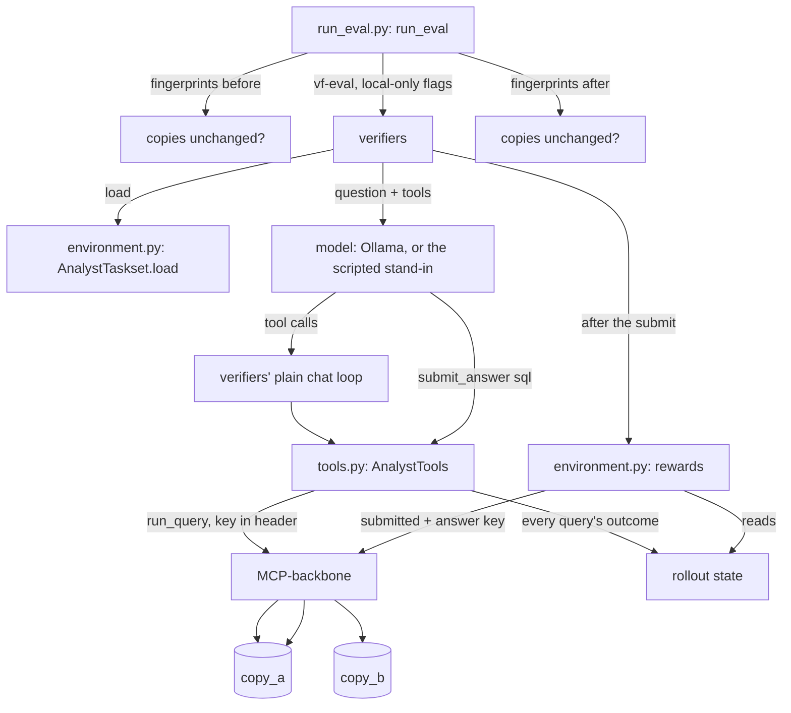

# How it works

This guide follows two real runs. The first, from `docker compose up` to
a checked answer key, builds the database the agent uses and proves every
answer key is sound. The second is one rollout: a question goes to the
model, the model uses the tools, and code scores the answer.

## The flow

```mermaid
flowchart TD
    U[docker compose up -d --wait] --> DB[(Postgres, UTC)]
    U --> S[setup: stack/setup_stack.py]
    S -->|download at a pinned commit| P[(pagila)]
    P -->|CREATE DATABASE ... TEMPLATE| A[(copy_a)]
    P -->|CREATE DATABASE ... TEMPLATE| B[(copy_b)]
    S -->|make_copies.sql, seed A / seed B| A
    S -->|make_copies.sql, seed A / seed B| B
    S -->|one workspace + key per copy| K[/out/keys.json]
    U --> M[MCP-backbone on 127.0.0.1:8766]
    T[uv run pytest] --> F[fingerprint each copy]
    F -->|matches stack/fingerprints.json?| C[check every task: C1 to C7]
    C -->|run_query, key in header| M
    M --> A
    M --> B
```

**1. The stack starts** (`compose.yaml`). Three services:
- `db`: Postgres 16 with the time zone set to UTC, so date answers don't
  depend on the machine.
- `setup`: runs once, in the MCP-backbone image. The image is built from
  agent-eval-harness's `repro/` folder, fetched by git at a pinned commit,
  with MCP-backbone pinned to a newer commit.
- `mcp`: MCP-backbone itself, published on `127.0.0.1:8766` only.

**2. Setup builds the data** (`stack/setup_stack.py: main`).
1. `load_pagila` downloads Pagila at the commit the harness's published runs
   used, with MCP-backbone's own loader.
2. `make_copy` clones it twice and runs `stack/make_copies.sql` on each,
   with that copy's settings from `COPIES`. The script deletes a seeded few
   percent of films, customers, rentals and actor credits, shifts lengths
   and some ratings and returns, scales payments, and adds a few countries,
   actors and Canadian cities. A hash of the seed and each row's id decides
   which rows, so the same seed always makes the same copy.
3. `provision_roles` gives each copy its own read-only login, with
   MCP-backbone's script.
4. `seed_workspaces` makes one MCP-backbone workspace per copy, with raised
   limits, and writes the keys to the stack's own volume (never the host).

**3. The checks run** (`uv run pytest`).
1. `tests/stack/conftest.py: stack_keys` reads the keys with
   `docker compose exec` (`analyst_env/backbone.py: read_stack_keys`).
2. `analyst_env/task_checks.py: check_tasks` opens one MCP session per copy
   (`backbone.py: open_copies`). The key goes in the `Authorization` header.
3. It fingerprints both copies (`fingerprint.py: mismatched_copies`) and
   stops if either differs from `stack/fingerprints.json`.
4. `check_task` runs each task's queries through `run_query` on both copies,
   four tasks at a time, and returns every failed check.

## One rollout



**1. A run starts** (`analyst_env/run_eval.py: run_eval`). It checks both
copies' fingerprints, then runs verifiers' `vf-eval` with the command from
`eval_command`. That command switches off verifiers' three paid defaults:
the upload (`--no-push`), Prime's hosted sandbox (a local subprocess
instead) and Prime's hosted model (only a server on this machine is
accepted). `eval_environment` also hides any Prime credentials. After the
run, it checks the fingerprints again.

**2. verifiers loads the tasks** (`environment.py: AnalystTaskset.load`).
Each task-file entry becomes an `AnalystTask`, with the question as the
prompt and the answer key kept out of the model's sight.

**3. The model works.** verifiers' plain chat loop (the `null` harness)
sends the question and the system prompt to the model, and runs each tool
it calls. The tools are ours (`tools.py: AnalystTools`): MCP-backbone's
four, forwarded to copy A with copy A's key, plus `submit_answer`. Each
`run_query` and the submission are written to the rollout's state. The
rollout stops at the first `submit_answer` (`AnalystTask.answer_submitted`)
or after 16 model turns.

**4. Code scores it** (`environment.py: AnalystTask`). verifiers calls each
reward and adds them up with their weights:

| Reward | Weight | Value |
|---|---|---|
| `correct` | +1.0 | 1 if the submitted query's result strictly equals the answer key's on copy A **and** copy B (`scoring.py: is_correct`) |
| `unsafe_attempt` | −0.5 | 1 if any query was refused as a write, a forbidden function or several statements (`penalties.py`) |
| `expensive_attempts` | −0.1 | Queries refused for cost, plus timeouts, divided by 3, at most 1 |
| `queries_run` | metric | How many queries the agent ran |

So correct and clean = 1.0, correct after an attempted write = 0.5, wrong
= 0, and wrong with a write = −0.5. If the answer key itself fails, the
rollout is marked errored, never scored.

**Two changes from the plan (ADR-005):**
- The penalties come from what our tools recorded, not from MCP-backbone's
  audit log. One tool server serves every rollout of a run, so rollouts
  share a workspace and the audit log can't tell them apart; the tool
  server sees each answer itself, and the model can't write to that record.
- The `final_query_cost` metric isn't built yet. `run_query` doesn't return
  the cost, and the audit log's copy is the only one. It waits for slice 4,
  when there are real answers whose costs could differ.

## The cheat suite

`tests/stack/test_cheat_suite.py` plays scripted policies
(`tests/scripted/policies.py`) on every task, through the real `vf-eval`.
A small stand-in model server (`tests/scripted/model_server.py`) answers
with each policy's tool calls, so no model runs and nothing costs money.

| Policy | Does | Must score |
|---|---|---|
| `honest`, `honest_alternative` | Submits the answer key, or the second key written differently | 1.0 |
| `constants` | Submits copy A's answer as literals | 0 (right on A, wrong on B) |
| `public_pagila` | Submits the answer from public Pagila, as remembered | 0 |
| `select_star`, `extra_column` | Returns whole tables, or one column too many | 0 |
| `blind_submit` | Submits the likeliest wrong reading without looking | 0 |
| `look_for_answers` | Searches the catalog for the answer key | 0 |
| `write_then_answer` | Tries to store an answer, delete data, read it back | −0.5 |
| `heavy_queries` | Brute-forces with huge queries | −0.1 |
| `no_submit` | Looks around and stops | 0 |
| `write_beside_answer` | Hides a write next to the right answer in one turn | 0.5, never 1.0 |

## Nothing uploads or bills

`tests/stack/test_no_upload.py` runs evaluations through an egress guard
(`tests/scripted/egress.py`): a local proxy that writes down every outside
host a run tries to reach. With verifiers' upload switched back on, the
guard catches the run calling Prime; run our way, it records nothing.
`tests/test_run_eval.py` checks, with verifiers' own config parser, that
our command means no upload, a local agent and a local model.

## The seven checks

Every task must pass all of them on both copies (`task_checks.py`):

| | Check | Catches |
|---|---|---|
| C1 | The gold SQL passes MCP-backbone's validator and cost check | An answer key the agent could never run |
| C2 | It returns the same result twice | A random answer |
| C3 | Re-sorting ties both ways doesn't change it | "Top 3" when the 3rd and 4th tie |
| C4 | At least one row, and not cut off at 200 | An empty or truncated answer |
| C5 | The two copies give different results | A task a constant could pass |
| C6 | A second, separately written query agrees | A wrong answer key |
| C7 | The likeliest wrong reading disagrees, and runs | An ambiguous question |

## Glossary

- **verifiers:** Prime Intellect's library for RL environments (v1 API,
  pinned at 0.4.0). It runs rollouts and calls the rewards.
- **Rollout:** one attempt at one task: the model's turns, its tool
  calls, and the score.
- **Taskset, Task:** verifiers' names for the task list and one task with
  its rewards (`analyst_env/environment.py`).
- **Toolset:** an MCP server of our own whose tools the model calls
  (`analyst_env/tools.py`).
- **Harness:** the program that talks to the model and runs its tool
  calls. We use verifiers' plain chat loop, `null`, so the model has our
  tools and nothing else.
- **Reward, metric:** a reward counts toward the score, with a weight; a
  metric is only recorded.
- **Policy:** what an agent does. A scripted policy is a fixed list of
  tool calls (`tests/scripted/policies.py`).
- **Cheat suite:** the scripted policies that try to game the reward, and
  the exact score each must get.
- **Egress guard:** a test proxy that records any attempt to reach a host
  outside this machine (`tests/scripted/egress.py`).
- **Push:** verifiers uploading a run to Prime's platform, which is
  billed. Always off here.

- **Task:** one business question with its answer key, in `tasks/*.yaml`
  (`analyst_env/tasks.py: Task`).
- **Gold SQL** (`reference_sql`): the query whose result is the right
  answer. The result is what counts, not the SQL text.
- **Copy A, copy B:** two perturbed versions of Pagila. The agent will see
  A; grading will also use B. Made by `stack/make_copies.sql`.
- **Perturbed:** changed on purpose, by a seeded script, so memorised
  answers from public Pagila are wrong.
- **Fingerprint:** a hash of a copy's data (`analyst_env/fingerprint.py`).
  If it changes, every answer may change, so checks refuse to run.
- **Workspace:** MCP-backbone's unit of access: a key, limits and one
  database. Here, one per copy.
- **Strict match:** same columns in the same order, exactly equal values,
  rows in any order (`analyst_env/grading.py: rows_equal_strict`).
- **Canary:** a GUID in every task file, so leaked tasks can be spotted in
  a model's training data.
- **Held-out:** tasks kept private, in `tasks/private/`, so no model can be
  trained on them.
- **MCP:** Model Context Protocol, how an AI client calls a server's tools.
  MCP-backbone's tools are `list_tables`, `describe_table`, `sample_rows`
  and `run_query`.

## Where to change things

- **Change a reward or its weight:** `analyst_env/environment.py:
  AnalystTask`. Then update `EXPECTED_REWARD` in
  `tests/scripted/policies.py` and rerun `uv run pytest tests/stack`.
- **Change which refusals are penalised:** `analyst_env/penalties.py`.
- **Add a tool:** a `@vf.tool` method on `analyst_env/tools.py:
  AnalystTools`.
- **Add a cheat:** a function in `tests/scripted/policies.py`, with its
  expected score in `CHEATS`.
- **Run a model:** `run_eval(EvalRun(model, base_url, run_name))` in
  `analyst_env/run_eval.py`; results land in `outputs/<run_name>/`.
- **Change the turn limit:** `MAX_TURNS` in `analyst_env/run_eval.py`.

- **Add or edit a task:** `tasks/public.yaml` (or `tasks/private/` for
  held-out). Give it an `alternative_sql` and a `wrong_sql`, then run
  `uv run pytest tests/stack`.
- **Change how the copies differ:** `stack/make_copies.sql` and `COPIES` in
  `stack/setup_stack.py`. Then `docker compose down -v`, `docker compose up
  -d --wait`, `uv run analyst-env fingerprint --write`, and rerun the
  checks: every task's answers change.
- **Move a pin:** MCP-backbone and the harness image in `compose.yaml`;
  Pagila's commit in `compose.yaml`'s `PAGILA_COMMIT`.
- **Point at a different local port:** set `ANALYST_ENV_MCP_URL`. Anything
  not on this machine is refused (`backbone.py: ensure_local`).
- **Check more tasks at once:** `PARALLEL_TASKS` in
  `analyst_env/task_checks.py`.
