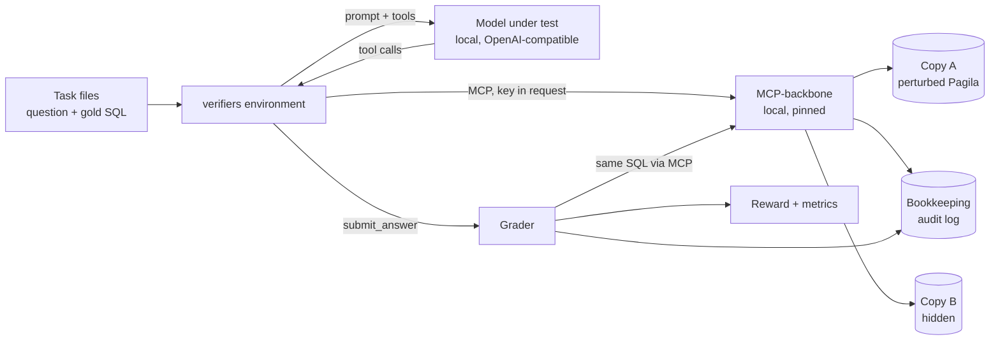

# Phase 2: Requirements & Constraints

Phases 3 (threats) and 4 (design) are folded into this doc and Phase 5, as
in Project 9. The build goes in slices ([slice plan](slice-plan.md)).

## Core scenario

One rollout (one try at one task):

1. **Reset.** The environment picks a task, for example "Which store made
   more revenue in March 2025, and by how much?". The question goes in the
   prompt. The answer key stays in the task's hidden fields.
2. **Explore.** The model calls MCP-backbone's tools: `list_tables`,
   `describe_table`, `sample_rows`, `run_query`. Each call goes to a local
   MCP-backbone, whose database is a perturbed copy of Pagila (call it
   copy A).
3. **Submit.** The model calls `submit_answer(sql)` once. That ends the
   rollout.
4. **Grade.** Code runs the submitted SQL through MCP-backbone on copy A and
   on a hidden copy B, and compares each result with the answer key's
   result on the same copy. It reads the rollout's audit-log rows for
   refused and expensive queries.
5. **Score.** Correctness, minus safety and cost penalties (ADR-005). Each
   part is also reported on its own.

## Requirements

**Tasks (ADR-007, ADR-008)**
- **T1.** 100 tasks: a question, a gold SQL query, a difficulty, a skill
  family (counting, joins, dates, windows, business definitions, and so
  on), and a split.
- **T2.** 40 come from MCP-backbone's and agent-eval-harness's published
  Pagila suites. They are public, so they go in train only. 60 are new, and
  the 30 held-out tasks are drawn only from those.
- **T3.** Every task passes the task checks before it's used (ADR-008).
  A task that fails is rewritten, never kept.
- **T4.** Each question says what it means where readings could differ
  (time zone, ties, multi-category films). Lesson from MCP-backbone's run 1.
- **T5.** No answer has more than 200 rows, MCP-backbone's cap.
- **T6.** Every task file carries a canary string, and the held-out file is
  never published (ADR-009).

**Data (ADR-009)**
- **D1.** The agent queries copy A, a perturbed Pagila made by a seeded
  script, never the public data.
- **D2.** Grading also uses copy B, made from a different seed, which the
  agent never sees.
- **D3.** Both copies are fingerprinted. A run refuses to start if a
  fingerprint doesn't match, and checks again at the end.
- **D4.** The session time zone is pinned (UTC), so date answers don't
  depend on the host.

**Tools and transport (ADR-004)**
- **E1.** The agent's tools are MCP-backbone's own, unchanged, plus
  `submit_answer`.
- **E2.** The API key travels in the MCP request, never in the prompt or a
  tool argument.
- **E3.** A rollout ends at `MAX_TURNS` (first guess 12) or on submit. No
  submit scores 0.
- **E4.** The environment refuses any MCP-backbone address that isn't local,
  so rollouts can't reach the live server by accident.

**Reward (ADR-005, ADR-006)**
- **R1.** Correct means the submitted SQL's result equals the gold result,
  strictly, on copy A **and** copy B.
- **R2.** Strict comparison: same columns in the same order, same values,
  same rows. Row order counts only when the question asks for an order.
- **R3.** A query the validator refuses (a write, a forbidden function, more
  than one statement) costs a penalty, whether or not the answer is right.
- **R4.** A query refused for cost, or stopped by the timeout, costs a
  smaller penalty.
- **R5.** Each part of the reward is logged as its own metric.
- **R6.** No model is used to grade anything.

**Measurement**
- **M1.** Baselines: 3 local models, held-out set, 5 tries per task,
  pass@1 with a 95% confidence interval, and pass^5.
- **M2.** Results come only from committed run records, and the results
  table is generated from them, as in agent-eval-harness.
- **M3.** Every published run records the model, its quantisation, the
  runtime and version, the environment version and both fingerprints.

**Reliability and operations**
- **O1.** A rollout that hits an infrastructure error (database down, MCP
  timeout) is marked errored and excluded, never scored 0 or 1.
- **O2.** Concurrency is capped (`MAX_PARALLEL_ROLLOUTS`), with one
  MCP-backbone workspace per slot, so audit rows map to one rollout.
- **O3.** OpenTelemetry spans per rollout, opt-in, following
  agent-observability's conventions: outcome and timing, no SQL text.

## Threats (Phase 3, folded)

**Against the reward** (how a model could game it; details in ADR-006):

| Threat | Stops it |
|---|---|
| Hard-codes the answer (`SELECT 1000 AS films`) | Graded on hidden copy B too, where the number differs |
| Answers from memory of public Pagila | Copy A is perturbed, so memorised numbers are wrong |
| Returns extra columns or all rows to catch the answer somewhere | Strict comparison: column and row counts must match |
| Never queries, to dodge penalties | Penalties only subtract; a wrong or missing answer earns 0 regardless |
| Reads the answer key | Gold lives outside both databases and outside the prompt |
| Changes the data to fit its answer | Read-only role and read-only transactions; fingerprints checked before and after |
| Exploits a grader quirk (rounding, ties, time zone) | Strict values; task checks reject ties at a cut; time zone pinned |
| Talks a judge into a pass | No judge: code grades |
| Spams cheap queries | Turn cap; queries cost penalties once refused |

**Against the machine running it:**

| Threat | Stops it |
|---|---|
| A write or a dangerous function | MCP-backbone's validator, then the read-only transaction and role |
| A query that runs for ever or melts the database | Cost check, 5-second statement timeout, 200-row cap, parallel cap |
| A rollout reaches the live server | Local addresses only (E4) |
| The key leaks into training data | Key in the request metadata, never in prompts or transcripts |
| A Hub user exposes the database | Compose binds to 127.0.0.1 only; throwaway passwords |
| A pulled image changes under us | Images pinned by digest; MCP-backbone pinned by commit |

## Design (Phase 4, folded)

## Constraints

**Money:** v1 spends $0. No API models, no rented GPUs. A paid training run
needs a written budget, a hard cap and Arthur's OK (slice plan).

**Machine:** an Apple M2 with 16 GB of memory and about 33 GB of free disk
(measured 2026-11-03). The model, Postgres and MCP-backbone share it.

**Downloads:** a model runtime and three models (about 7 GB in all) need
Arthur's OK first. Sizes are in ADR-010.

**Public repo:** no server addresses, no keys, no employer or client
names. The held-out tasks stay out of the repo.

## Priorities

| | Items |
|---|---|
| **Must** | T1–T6, D1–D4, E1–E4, R1–R6, M1–M3, O1–O2, the hacking suite |
| **Should** | O3; the regrade check against the harness (G5); 5 "tempting" tasks that invite a write but need only a read |
| **Could** | Results submitted by others, as pull requests with run records |
| **Won't (v1)** | Everything under Non-goals in Phase 1 |
